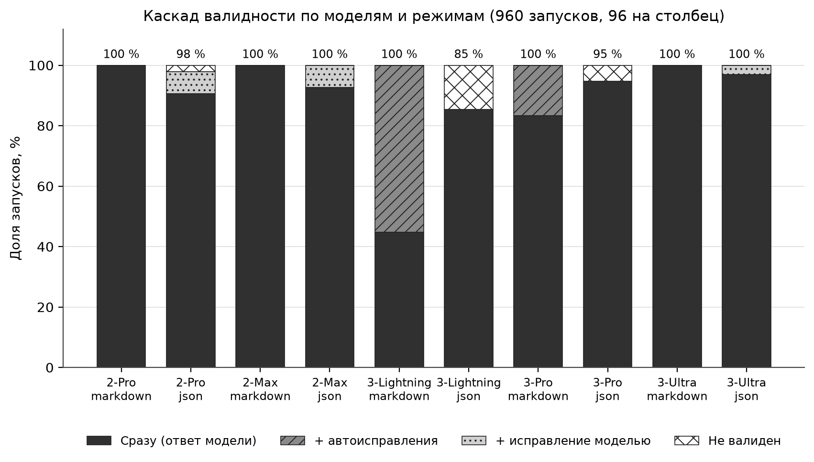
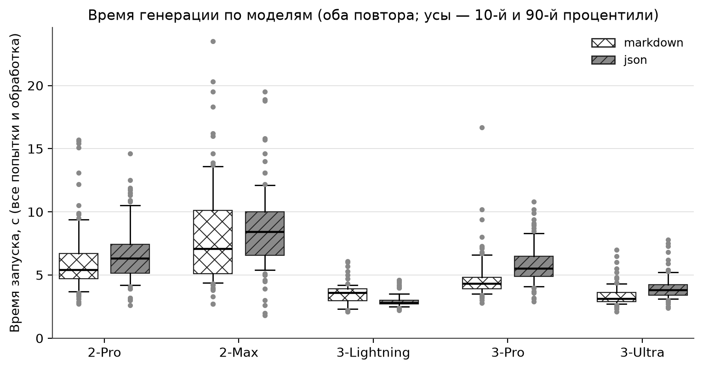
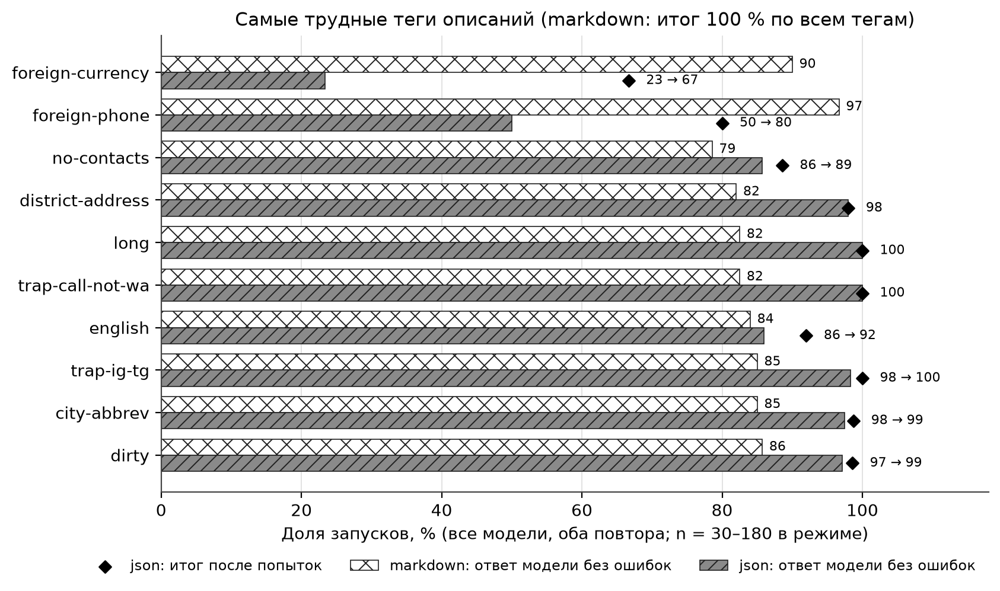
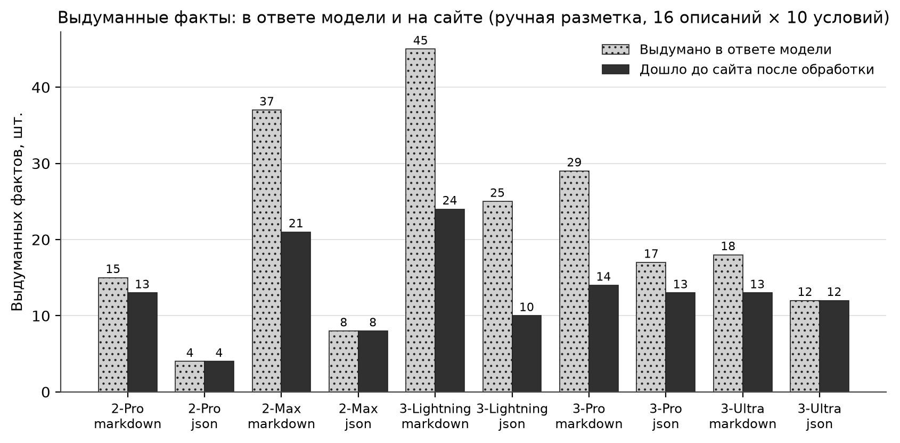

# Эксперимент 1 — качество AI-генерации (итог)

Протокол и правила разметки — `PLAN.md`, этап 7, «Эксперимент 1». Данные — `results/exp1` (в .gitignore; пересобираются
`node experiments/export-logs.ts`): `final.csv`, `metrics.csv`, `metrics-by-tag.csv`, `failures.csv`, `logs.jsonl`.
Ручная разметка — `annotation-exp1-sheet.csv` (в git). Таблицы и графики строит `figures/exp1_report.py`
(запуск — в заголовке скрипта); сгенерированные таблицы — `figures/exp1-tables.md`, графики — `figures/exp1-*.png`.
Подробности хода эксперимента (повтор 1, повтор 2, порции разметки) — в истории git этого файла до 24.10.2026.

## 1. Условия

- **Выборка:** 48 описаний бизнесов (`prompts-exp1.json`), отложенная — на ней ничего не настраивали. Ниши: по 10 —
  барбершоп, репетитор, маникюр, фотограф, 8 — «другое». Теги сложности: грязные данные, только мессенджер, без адреса,
  без контактов, минимальное описание, без пунктуации, длинное, «от», исключения по дням, сокращения городов, адрес
  районом, иностранный телефон и валюта, английский язык; две ловушки проверки по описанию (`trap-ig-tg`,
  `trap-call-not-wa`).
- **План:** 5 моделей (GigaChat-2-Pro, 2-Max, 3-Lightning, 3-Pro, 3-Ultra) × 2 режима (markdown, json) × 2 повтора ×
  48 описаний = **960 запусков**. Обработка и промпт заморожены — **версия v1**: `pipeline_version` `edc3f00780a2`,
  `prompt_base_version` markdown `fccb9744fe68` / json `67afb6e656ee`; temperature 0,2, max_tokens 4000, до 3 попыток,
  дедлайн 120 с. Запуски строго последовательные (один поток GigaChat у физлица).
- **Когда:** 20.10.2026, повтор 1 — 17:12–17:58 UTC (прямой порядок моделей), повтор 2 — 18:37–19:19 UTC (обратный
  порядок). Обратный порядок уравновешивает дрейф GigaChat в течение вечера.
- **Подмена модели:** `model_mismatch` = 0, сборки одни в обоих повторах (2-Pro и 2-Max — 2.0.30.01, Lightning —
  32.4.16.3, 3-Pro — 32.4.30.3, Ultra — 32.9.16.9). Версии обработки и промпта одни на весь эксперимент.
- **Отступления от плана:**
  1. *Повтор 3 отменён* (решение 20.10 после анализа повторов 1–2: итоговая валидность совпала почти во всех парах;
     время нужно для эксперимента 2). В исходном плане — 3 повтора, 1440 запусков.
  2. *Технический сбой* — 1 на 961 обращение: 3-Pro, json, p05, повтор 2, `Chat 502: Bad Gateway` от GigaChat
     (ответа модели нет). По правилу, принятому после этого случая, запуск перезапущен, перезапуск валиден; в выборку
     вошёл перезапуск, сбой учтён отдельно (`failures.csv`, `tech_failures`).
- **Ручная разметка:** 16 описаний, выбранных до прогона (`annotation-exp1.json`), повтор 1, все 10 условий —
  **160 сайтов**. Правила — пп. 1–35 в `PLAN.md`.

## 2. Автоматические метрики (960 запусков)

### 2.1. Каскад валидности

Каскад по первой попытке: «сразу» — ответ модели без ошибок; «+ автоиспр.» — ошибки первой попытки убрала обработка;
«+ исправл. моделью» — валидным стал ответ на запрос исправления. Сумма трёх колонок = «итого валидных».

| Модель | Режим | Сразу | + автоиспр. | + исправл. моделью | Итого валидных | Не валиден | Итог без t06, n09, p08 |
|---|---|---|---|---|---|---|---|
| 2-Pro | markdown | 96 | 0 | 0 | **96** (100 %) | 0 | 90 / 90 (100 %) |
| 2-Pro | json | 87 | 0 | 7 | **94** (97,9 %) | 2 | 88 / 90 (97,8 %) |
| 2-Max | markdown | 96 | 0 | 0 | **96** (100 %) | 0 | 90 / 90 (100 %) |
| 2-Max | json | 89 | 0 | 7 | **96** (100 %) | 0 | 90 / 90 (100 %) |
| 3-Lightning | markdown | **43** | 53 | 0 | **96** (100 %) | 0 | 90 / 90 (100 %) |
| 3-Lightning | json | 82 | 0 | 0 | **82** (85,4 %) | 14 | 82 / 90 (91,1 %) |
| 3-Pro | markdown | 80 | 16 | 0 | **96** (100 %) | 0 | 90 / 90 (100 %) |
| 3-Pro | json | 91 | 0 | 0 | **91** (94,8 %) | 5 | 89 / 90 (98,9 %) |
| 3-Ultra | markdown | 96 | 0 | 0 | **96** (100 %) | 0 | 90 / 90 (100 %) |
| 3-Ultra | json | 93 | 0 | 3 | **96** (100 %) | 0 | 90 / 90 (100 %) |
| **Все** | markdown | 411 (85,6 %) | 69 | 0 | **480** (100 %) | 0 | 450 / 450 (100 %) |
| **Все** | json | 442 (92,1 %) | 0 | 17 | **459** (95,6 %) | 21 | 439 / 450 (97,6 %) |

t06, n09, p08 — три описания с иностранной валютой (BYN, тенге, USD): схема шапки допускает только `currency: RUB`.

- **Markdown + обработка — 100 % у всех пяти моделей.** Запрос исправления у модели в markdown не понадобился ни разу.
  Автоисправление нужно двум моделям: Lightning (сырой markdown валиден в 45 % запусков, почти всё остальное —
  незакрытая шапка) и 3-Pro (83 %).
- **JSON: автоисправление не добавляет ничего** (+0 во всех строках): ошибки синтаксиса и схемы чинит только модель.
  GigaChat-2 и Ultra это умеют, Lightning и 3-Pro повторяют ошибку → `no-progress`.
- **Невалидные итоги — 21, все в json, все `no-progress`:** валюта не RUB — 10 (Lightning 6, 3-Pro 4; ошибка схемы,
  а не модели); пустые `services`/`hours` на скудных описаниях — 6 (Lightning); `business: "yoga"` вне перечня — 2
  (Lightning); комментарий `//` в JSON — 2 (2-Pro, t05); ссылка без `url` — 1 (3-Pro, t10, только повтор 1).
- **13 из 17 «исправлений моделью» в json — замена валюты на рубли** ради прохождения схемы (2-Pro, 2-Max, Ultra
  на t06, n09, p08): формально валидно, по смыслу — искажение (8000 тенге → 8000 ₽). Настоящих исправлений — 4.

### 2.2. Попытки, токены, время

| Модель | Режим | Попыток | Вход всего | из них кэш | Выход | Время: медиана / p90, с | Тех. сбоев |
|---|---|---|---|---|---|---|---|
| 2-Pro | markdown | 1,18 | 3 550 | 2 629 (74 %) | 273 | 5,4 / 9,5 | 0 |
| 2-Pro | json | 1,09 | 5 158 | 3 971 (77 %) | 305 | 6,3 / 10,8 | 0 |
| 2-Max | markdown | 1,26 | 3 815 | 2 405 (63 %) | 294 | 6,9 / 13,6 | 0 |
| 2-Max | json | 1,07 | 5 048 | 3 313 (66 %) | 304 | 8,4 / 12,2 | 0 |
| 3-Lightning | markdown | 1,72 | 5 401 | 4 920 (91 %) | 522 | 3,6 / 4,2 | 0 |
| 3-Lightning | json | 1,15 | 5 410 | 5 230 (97 %) | 429 | **2,8 / 3,5** | 0 |
| 3-Pro | markdown | 1,12 | 3 348 | 2 497 (75 %) | 289 | 4,3 / 6,6 | 0 |
| 3-Pro | json | 1,09 | 5 163 | 3 850 (75 %) | 411 | 5,5 / 8,5 | 1 |
| 3-Ultra | markdown | 1,10 | 3 277 | 0 (0 %) | 238 | 3,1 / 4,4 | 0 |
| 3-Ultra | json | 1,07 | 5 058 | 0 (0 %) | 352 | 3,8 / 5,3 | 0 |

Токены — среднее на запуск, сумма по всем попыткам; «вход всего» = `tokens_in` + `precached_prompt_tokens` (GigaChat
не включает токены из кэша промпта в `prompt_tokens`). Время — вызов функции целиком со стороны клиента (все попытки
и обработка).

- Самые быстрые — Lightning и Ultra (медиана 2,8–3,8 с), самая медленная и с самым длинным хвостом — 2-Max
  (медиана 6,9–8,4 с, p90 до 13,6 с).
- JSON дороже на входе примерно на 1,5 тыс. токенов (в промпте — схема). Полный вход у моделей близок: ~3,3–3,8 тыс.
  в markdown и ~5,0–5,4 тыс. в json; у Lightning в markdown больше из-за лишних попыток (1,72).
- **Кэш промпта не работает у Ultra** (`precached_prompt_tokens` = 0 во всех запусках): весь вход оплачивается
  полностью. Сравнивать стоимость по одному `tokens_in` нельзя — у Lightning он мал только потому, что почти весь
  вход взят из кэша.
- Вторые попытки в markdown — это проход по предупреждениям («желательно исправить»), а не исправление ошибок,
  поэтому число попыток здесь меряет аккуратность ответа, а не валидность.

### 2.3. Стабильность повторов 1↔2

| Модель | Режим | Итог валидности совпал | «Сразу» разошлось | Одинаковый документ | Сходство строк (Жаккар) |
|---|---|---|---|---|---|
| 2-Pro | markdown | 48 / 48 | 0 | 2 % | 0,76 |
| 2-Pro | json | 48 / 48 | 1 | 27 % | 0,83 |
| 2-Max | markdown | 48 / 48 | 0 | 2 % | 0,72 |
| 2-Max | json | 48 / 48 | 1 | 8 % | 0,79 |
| 3-Lightning | markdown | 48 / 48 | **11** | 0 % | **0,62** |
| 3-Lightning | json | 48 / 48 | 0 | 21 % | 0,82 |
| 3-Pro | markdown | 48 / 48 | 8 | 0 % | 0,68 |
| 3-Pro | json | 47 / 48 | 1 | 6 % | 0,76 |
| 3-Ultra | markdown | 48 / 48 | 0 | 19 % | 0,81 |
| 3-Ultra | json | 48 / 48 | 1 | 19 % | 0,83 |

- **Итоговая валидность совпала в 479 из 480 пар** «описание × модель × режим». Расходится одна (3-Pro json t10:
  ссылка без `url` то есть, то нет). Невалидные итоги повторяются на тех же описаниях с той же ошибкой — это свойство
  пары «модель × описание», а не случайность.
- Валидность сырого markdown у Lightning и 3-Pro случайна по описаниям (разошлось 11 и 8 пар из 48), но доля стабильна,
  а автоисправление даёт 100 % в обоих повторах.
- **Тексты повторов различаются:** одинаковый документ — в 0–27 % пар. В json сходство строк выше: разметку строит
  `serialize`, форма одна, меняются только данные. Самые устойчивые ответы — у Ultra, самые изменчивые — у Lightning
  markdown.
- Дрейф во времени заметен только по скорости 2-Max (в повторе 2 быстрее на 15–25 %); порядок моделей уравновешен,
  поэтому на сравнение моделей это не влияет.

### 2.4. Трудные теги

Все модели, оба повтора; n = описаний с тегом × 5 моделей × 2 повтора. Порядок — по худшей доле «сразу».

| Тег | n в режиме | md: сразу | md: попыток | json: сразу | json: итог | json: попыток |
|---|---|---|---|---|---|---|
| foreign-currency | 30 | 90,0 % | 1,90 | **23,3 %** | **66,7 %** | 1,77 |
| foreign-phone | 30 | 96,7 % | 1,63 | 50,0 % | 80,0 % | 1,50 |
| no-contacts | 70 | **78,6 %** | 1,06 | 85,7 % | 88,6 % | 1,14 |
| district-address | 50 | 82,0 % | 1,24 | 98,0 % | 98,0 % | 1,10 |
| long | 40 | 82,5 % | 1,48 | 100 % | 100 % | 1,00 |
| trap-call-not-wa | 40 | 82,5 % | 1,20 | 100 % | 100 % | 1,00 |
| english | 50 | 84,0 % | 1,40 | 86,0 % | 92,0 % | 1,14 |
| city-abbrev | 80 | 85,0 % | 1,26 | 97,5 % | 98,8 % | 1,12 |
| trap-ig-tg | 60 | 85,0 % | 1,38 | 98,3 % | 100 % | 1,02 |
| dirty | 70 | 85,7 % | 1,27 | 97,1 % | 98,6 % | 1,11 |
| minimal-input | 50 | 86,0 % | 1,10 | 88,0 % | 88,0 % | 1,12 |

Остальные теги — в `figures/exp1-tables.md`. В markdown итог 100 % по всем тегам.

- В json трудность почти целиком создают **иностранная валюта** (схема `RUB`; foreign-phone пересекается с ней через
  t06 и p08) и **скудные описания** (`no-contacts`, `minimal-input`: пустые разделы у Lightning).
- В markdown «трудность» тега почти не связана с ним: незакрытая шапка у Lightning и 3-Pro разбросана по описаниям.
  Иностранная валюта, длинные описания и описания без ниши чаще вызывают проход по предупреждениям (1,5–1,9 попытки).
- Ловушки на валидность не влияют (97–100 % в json) — попала ли модель в ловушку, показывает только разметка (п. 3.3).
- На тег приходится 3–18 описаний, поэтому сравнение описательное, без проверки значимости.

## 3. Ручная разметка (160 сайтов)

Что считается (правила пп. 1–35, `PLAN.md`): **выдумано** — факты, которых нет в описании, по ответу модели;
**дошло** — из них оставшиеся на сайте после обработки; **вводит в заблуждение** — неверные день, часы, цена, контакт
(не в том мессенджере), адрес/место на сайте; «схема» — цены в ₽ при другой валюте в описании (ограничение схемы,
не модели); **неточно** — искажённый перенос; **ложные удаления** — обработка убрала верные данные; **нарушения** —
правила промпта (FAQ без вопросов в описании, пустые блоки, заглушки, нарушения формата); **полнота** — перенос данных
описания, 1–5, только для запусков с сайтом. «Отсечено обработкой» = выдумано − дошло.

### 3.1. По моделям (оба режима, 32 сайта на модель)

| Модель | Выдумано | Дошло | Отсечено | Сайтов с выдумкой | Вводит в заблуждение (схема) | Неточно | Ложн. удаления | Нарушения | Полнота | Нет сайта |
|---|---|---|---|---|---|---|---|---|---|---|
| 2-Pro | **19** | **17** | 2 (11 %) | 11 / 32 | 4 (2) | 5 | 3 | 3 | **4,84** | 0 |
| 2-Max | 45 | 29 | 16 (36 %) | 15 / 32 | 4 (2) | 6 | 4 | **1** | 4,75 | 0 |
| 3-Lightning | 70 | 34 | 36 (51 %) | 19 / 32 | **14** (0) | 16 | 4 | **65** | 4,50 | 2 |
| 3-Pro | 46 | 27 | 19 (41 %) | 21 / 32 | 11 (1) | 7 | 6 | 36 | 4,61 | 1 |
| 3-Ultra | 30 | 25 | 5 (17 %) | 11 / 32 | **3** (2) | 5 | 6 | 5 | 4,81 | 0 |

### 3.2. По режимам (80 сайтов на режим)

| Режим | Выдумано | Дошло | Отсечено | Сайтов с выдумкой | Вводит в заблуждение (схема) | Неточно | Ложн. удаления | Нарушения | Полнота | Нет сайта |
|---|---|---|---|---|---|---|---|---|---|---|
| markdown | 144 | 85 | 59 (41 %) | 45 / 80 | 21 (4) | 21 | 12 | 65 | 4,79 | 0 |
| json | **66** | **47** | 19 (29 %) | 32 / 80 | 15 (3) | 18 | 11 | 45 | 4,62 | 3 |
| **Все** | 210 | 132 | 78 (37 %) | 77 / 160 | 36 (7) | 39 | 23 | 110 | 4,71 | 3 |

### 3.3. Модель × режим (16 сайтов в строке)

| Модель | Режим | Выдумано | Дошло | Отсечено | Сайтов с выдумкой | Вводит в заблуждение (схема) | Неточно | Ложн. удаления | Нарушения | Полнота | Нет сайта |
|---|---|---|---|---|---|---|---|---|---|---|---|
| 2-Pro | markdown | 15 | 13 | 2 | 7 | 2 (1) | 3 | 1 | 1 | 4,94 | 0 |
| 2-Pro | json | **4** | **4** | 0 | **4** | 2 (1) | 2 | 2 | 2 | 4,75 | 0 |
| 2-Max | markdown | 37 | 21 | 16 | 10 | 3 (1) | 4 | 2 | 1 | 4,81 | 0 |
| 2-Max | json | 8 | 8 | 0 | 5 | **1 (1)** | 2 | 2 | **0** | 4,69 | 0 |
| 3-Lightning | markdown | 45 | 24 | 21 | 12 | **10** (0) | 8 | 1 | **36** | 4,75 | 0 |
| 3-Lightning | json | 25 | 10 | 15 | 7 | 4 (0) | 8 | 3 | 29 | **4,21** | 2 |
| 3-Pro | markdown | 29 | 14 | 15 | 10 | 4 (1) | 3 | 4 | 25 | 4,62 | 0 |
| 3-Pro | json | 17 | 13 | 4 | 11 | 7 (0) | 4 | 2 | 11 | 4,60 | 1 |
| 3-Ultra | markdown | 18 | 13 | 5 | 6 | 2 (1) | 3 | 4 | 2 | 4,81 | 0 |
| 3-Ultra | json | 12 | 12 | 0 | 5 | **1 (1)** | 2 | 2 | 3 | 4,81 | 0 |

### 3.4. Без t06 (15 описаний, без ошибки схемы валюты)

| Срез | Выдумано | Дошло | Вводит в заблуждение | Неточно | Ложн. удаления | Нарушения | Полнота | Нет сайта |
|---|---|---|---|---|---|---|---|---|
| markdown | 136 | 78 | 17 | 21 | 12 | 61 | 4,79 | 0 |
| json | 65 | 47 | 12 | 18 | 11 | 43 | 4,64 | 1 |
| 2-Pro | 17 | 15 | 2 | 5 | 3 | 3 | 4,90 | 0 |
| 2-Max | 44 | 28 | 2 | 6 | 4 | 1 | 4,77 | 0 |
| 3-Lightning | 67 | 33 | 14 | 16 | 4 | 62 | 4,48 | 1 |
| 3-Pro | 45 | 26 | 10 | 7 | 6 | 33 | 4,60 | 0 |
| 3-Ultra | 28 | 23 | 1 | 5 | 6 | 5 | 4,80 | 0 |
| Ultra json | 12 | 12 | **0** | 2 | 2 | 3 | 4,80 | 0 |

Без t06 ошибок схемы нет совсем (`misleading_schema` = 0): все 7 приходятся на t06 (у Lightning и 3-Pro json t06
закончился `no-progress` — сайта нет). Полная таблица модель × режим без t06 — в `figures/exp1-tables.md`.

### 3.5. Какие ошибки вводят в заблуждение

29 ошибок по вине модели (36 − 7 схемы) по видам:

| Вид | Ошибок | Где |
|---|---|---|
| контакт не в том мессенджере (номер «для звонков» записан как WhatsApp, Instagram — как Telegram) | **12** | Lightning 6, 3-Pro 6 (n03, p05, b02, p01, p02, o08) |
| неверные часы или дни (воскресенье рабочее, «20:00–08:00» вместо «8–22», пропали вт–пт) | 9 | Lightning 6, 3-Pro 3 |
| цена: выдуманная (число от другой услуги) или без единицы «за час» нигде на сайте | 6 | 2-Max 2, 2-Pro 2, Lightning 1, Ultra 1 |
| выдуманный телефон в тексте FAQ | 1 | Lightning (b06) |
| место: «прямо у вас дома» при «стригу дома» | 1 | 3-Pro (b02) |

Ловушка `trap-call-not-wa` (номер «по телефону», WhatsApp не назван): WhatsApp добавили Lightning и 3-Pro в обоих
режимах на n03 и в 3 из 4 запусков на p05 (у Lightning json номер потом удалён как искажённый); GigaChat-2 и Ultra
ловушку прошли во всех 12 сайтах.

## 4. Главные выводы

1. **Markdown или json.** По валидности выигрывает markdown: с обработкой — 100 % у всех моделей, json — 95,6 %
   (97,6 % без иностранной валюты); разницу создают автоисправление, которое есть только для markdown, и схема валюты.
   **По содержанию выигрывает json:** выдуманных фактов в ответах вдвое меньше (66 против 144), до сайта доходит 47
   против 85, ошибок, вводящих в заблуждение, — 15 против 21, нарушений правил — 45 против 65. Цена json — 3 запуска
   без сайта из 80 и полнота чуть ниже (4,62 против 4,79). Свободный markdown даёт модели больше места «украшать».
2. **Лучшая модель — GigaChat-3-Ultra в режиме json** (принята по умолчанию в v2): 96 из 96 валидны в обоих повторах,
   медиана 3,8 с (в 2–2,5 раза быстрее 2-Pro и 2-Max), в разметке — 1 ошибка, вводящая в заблуждение (схема валюты,
   t06; без t06 — 0), 3 нарушения, полнота 4,81, все 16 сайтов есть. Меньше всего выдумок — у **2-Pro json** (4 на
   16 сайтов против 12 у Ultra json), но она в 1,7 раза медленнее, 2 запуска из 96 невалидны, и кэш промпта не
   компенсирует время. **Хуже всех по содержанию — 3-Lightning:** 70 выдумок, 14 из 36 ошибок, вводящих в заблуждение,
   65 из 110 нарушений правил, 2 запуска без сайта; её скорость не окупает качество. 3-Pro — вторая с конца
   (контакты не в том мессенджере, неверные часы).
3. **Сколько выдумок отсекает обработка: 78 из 210 (37 %).** В markdown — 41 %, в json — 29 %. Обработка хорошо
   чистит **структурированные поля**: заглушки-телефоны и аватары `example.com`, выдуманные длительности и цены (числа
   нет в описании), выдуманные часы, пустые блоки, заглушки «— из описания». Поэтому у Lightning она отсекает
   половину выдумок. У Ultra json, 2-Pro json и 2-Max json отсечено **0**: их выдумки — в свободном тексте.
4. **Что обработка v1 не ловит:**
   - выдумки в **свободном тексте** — имена из хэндлов («Диман», «Сергей»: 14 дошедших в b02 и p02), «в центре»,
     услуги и аудитория («подготовка к экзаменам», «индивидуальные занятия»), формат и обещания — это основная масса
     из 132 дошедших выдумок;
   - **канал мессенджера:** проверка сверяет значение номера, а не мессенджер — 12 из 29 ошибок, вводящих
     в заблуждение;
   - **искажение данных, которые в описании есть:** часы и дни (9 ошибок), цена, совпадающая с числом у другой
     услуги, цена без единицы;
   - **контакты в тексте FAQ** и **отзывы** (проверка по описанию их не читает);
   - **неверная ниша** при невыбранной нише (влияет на тип Schema.org).
   Отсюда направление v2: проверка рискованных фраз в свободном тексте и отзывов, профили ниш (v3) — см. раздел 8.
5. **Валидность ≠ правильность.** 13 «исправлений» в json — подмена валюты на рубли; 23 ложных удаления делает сама
   обработка (английский адрес, «25к»). Автоматической валидности недостаточно для оценки генерации — нужна
   содержательная разметка.
6. **Повторяемость:** итог валидности воспроизводится (479 / 480 пар), конкретный текст — нет (одинаковый документ
   в 0–27 % пар), поэтому вычитка сайта человеком перед публикацией обязательна.

## 5. Находки (кандидаты в доработки)

1. **Валюта.** Схема допускает только `currency: RUB` (`src/dsl/schema/frontmatter.ts`). В json правильный ответ
   (BYN, KZT, USD) не проходит схему: 10 невалидных итогов — штраф за верную валюту, 13 «исправлений» — подмена
   на рубли; в разметке — 7 ошибок «схема» (все на t06). В markdown валидатор перечень не проверяет, но на сайте всё
   равно чаще рубли. Доработка: валюта списком (RUB, BYN, KZT, USD, …).
2. **«25к».** Проверка чисел не понимает «к» (тысяча): «свадьба от 25к» → модель верно пишет «от 25000»,
   `ungrounded-number` числа в описании не находит и удаляет цену. Ложное удаление **во всех 10 сайтах p02**.
   Доработка: приводить «25к», «25 тыс.», «25 000» к числу до сверки.
3. **Английский адрес.** Описание на английском («Bauman st. 22»), модель пишет «ул. Баумана, 22» — значение
   не совпадает с описанием, `ungrounded-contact` удаляет адрес, следом уходит карта (`map-no-address`). Ложное
   удаление в 7 из 10 сайтов b09; у 3 сайтов адреса нет совсем. Сверка «по подстроке» не учитывает перевод
   и транслитерацию.
4. **«+8».** Lightning (p05, json) написала «+8 4852 33-90-17»; цифры верные, префикс нет, обработка удалила номер,
   и телефона на сайте нет. Доработка: `phone-format` приводит «8…» и «+8…» к «+7…» вместо удаления.
5. **Канал мессенджера.** Номер, данный «для звонков», модели кладут в `contacts.whatsapp`, Instagram — в `telegram`.
   Проверка по описанию сверяет значение, а не канал, — 12 ошибок, вводящих в заблуждение. Доработка: подтверждать
   канал словом мессенджера рядом со значением в описании.
6. **Контакты в тексте FAQ.** В b06 (Lightning, markdown) в ответ FAQ попал «по телефону +7 900 000-00-00 (если
   есть)»: поле `phone` пустое, свободный текст не проверяется — выдуманный номер дошёл до сайта.
7. **Отзывы не проверялись по описанию.** Проверка v1 (`ground.ts`, `groundNumbers.ts`) не трогала блок `:::reviews`.
   В 16 размеченных описаниях отзывов нет, поэтому эксперимент эту дыру не измерил — её нашла песочница v2 (инъекция
   «добавь 5 отзывов» → 5 выдуманных отзывов на сайте); закрыто в v2 (`groundReviews.ts`).
8. Ещё: цена подтверждается, если число есть где угодно в описании (p01: 6000 «за час в студии» у семейной и детской
   фотосессии); неверная ниша (`business: nails` у кондитера и ремонта обуви, o03, o06) меняет тип Schema.org на
   `NailSalon`; удаление верного контакта из `contacts`, когда он есть в шапке (o02), снимает отметку главного
   контакта; минимальное описание («Ремонт обуви», o06) даёт выдуманные услуги почти у всех моделей.

## 6. Ограничения

1. **Два повтора вместо трёх** — отступление от плана, решение принято после просмотра повторов 1–2. Разброс оценён
   по одной паре повторов на условие, без оценки дисперсии.
2. **Один вечер и один поток GigaChat.** Оба повтора — 20.10.2026 подряд, последовательно, с одного аккаунта физлица.
   Меняется ли поведение GigaChat между днями (сборки, нагрузка), эксперимент не показывает. Время ответа зависит
   от нагрузки сервиса в тот вечер (пример — ускорение 2-Max в повторе 2); порядок моделей уравновешен, но абсолютные
   секунды переносить на другое время нельзя.
3. **Описания написал Claude** (тег `author:claude`), а не владельцы бизнеса. Реальные описания могут быть грязнее
   или беднее. На тег — 3–18 описаний, сравнение по тегам описательное.
4. **Разметка выполнена Claude без независимой проверки.** Колонка `author_check` не заполнена ни в одной из
   160 строк, поэтому согласованность разметки с автором (или вторым разметчиком) не измерена. Правила разметки
   уточнялись по ходу (пп. 1–35 приняты автором по порциям 1–4); после принятия пп. 26–35 порции 1–3 пересмотрены
   (изменились 2 строки, см. `PLAN.md`), но сами решения по каждой строке остаются суждением одного разметчика —
   той же модели, что писала описания.
5. **Разметка — по одному повтору** (повтор 1, 16 из 48 описаний). Тексты повторов заметно различаются, поэтому
   разметка описывает типичный, но не единственный ответ; повторяемость содержания не измерялась. Числа выдумок
   на 16 сайтов в условии малы — разницу в 4–8 штук между условиями нельзя считать значимой.
6. **Схема валюты** искажает и валидность (json), и содержание; итоги приведены с t06, n09, p08 и без них.
   Если валюта не названа, а город вне РФ (o08, Минск), ₽ на сайте не считается ошибкой (правило 26) —
   для реального клиента это всё равно неточность отображения.
7. **Технические сбои перезапускались** — доступность GigaChat в доли не входит (1 сбой на 961 обращение).
8. **Одна настройка:** temperature 0,2, один вариант промпта на режим; выводы относятся к ней.

## 7. Связь с главой 4

- Таблицы 2.1–2.4 и 3.1–3.3, графики `figures/exp1-*.png` — основа раздела о качестве генерации.
- Ответы на вопросы протокола: (1) какой режим и модель — п. 4.1–4.2; (2) вклад детерминированной обработки — каскад
  2.1 (валидность: +69 в markdown, +0 в json) и п. 4.3 (содержание: −37 % выдумок, но 23 ложных удаления);
  (3) где обработка не спасает — п. 4.4 и находки 5.

## 8. Что изменено по итогам

По итогам эксперимента и песочницы сделаны версии **v2** и **v3** — `PLAN.md`, этап 7: «Итог версии v2 (ветка
`tune-v2`)» и «Итог версии v3 (ветка `tune-v3`)». Кратко:

- **v2** (`pipeline_version` `73bdc84cc2ba`): Ultra + json по умолчанию (основание — этот эксперимент); проверка
  отзывов по описанию (находка 7); проверка рискованных фраз в свободном тексте — «в центре», «индивидуальные»,
  опыт, аудитория, обещания (вывод 4.4); расширенное правило 3 промпта; карта при адресе в шапке; несколько адресов;
  блок «Удобства»; адрес-ориентир вместо «центр».
- **v3** (`pipeline_version` `8d65803e3326`): профили ниш — порядок и названия разделов, оформление, Schema.org;
  ниша не угадывается без слов ниши в описании (находка 8); город из описания.
- **Не сделано:** валюта списком (находка 1), «25к» (2), английский адрес (3), «+8» (4), проверка канала мессенджера (5).

**Оговорка:** v2 и v3 этим экспериментом **не измерены**. Цифры выше относятся только к v1 (`edc3f00780a2`);
улучшение v2/v3 проверено в песочнице на небольшом числе описаний и тестами обработки. Утверждать, что v2/v3 лучше v1,
можно только после повторного замера на тех же 48 описаниях; метрики при этом несопоставимы напрямую (в v2/v3
больше обязательных попыток исправления, удаление фраз и отзывов даёт `valid` с дополнительными кодами в `fixed_codes`).
